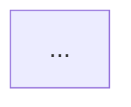

Analyze the code at `$path` and write a `README.md` in that folder.

## Rule Priority

When skill files give conflicting guidance, apply this hierarchy:

1. **User request and task instructions in this file**
2. **`semantic-types.md`** — canonical semantic type → color, shape, when to use
3. **`architecture.md`** — abstraction levels and architectural correctness
4. **`rendering.md`** — layout, spacing, and Mermaid syntax/rendering

If any file disagrees with `semantic-types.md` on color or shape, **`semantic-types.md` wins**.

## Step 1 — Read the code

Read every source file in the target folder. Understand:

- class/function names and their responsibilities
- inheritance or composition chains
- data flow and dependencies between modules
- what external systems are touched (APIs, backends, third-party libs)
- public interface vs internal implementation details

Do not guess or rely on file names alone. Read the actual source.

## Step 2 — Plan the sections

Every README follows this structure:

1. **Overview diagram** — one high-level `flowchart` showing the main actors and how they connect. Always included.
2. **Specific diagram sections** — one section per meaningful concern (class hierarchy, data flow, etc.). Each has a `##` heading, a diagram, and 2–3 lines of description.
3. **Key Concepts** — non-obvious patterns, invariants, gotchas. Only include if there's something worth saying that doesn't belong in a diagram description.

Decide which specific diagrams to generate based on what you found:

| What you see | Diagram type |
|---|---|
| ES6 class hierarchy (`extends`) | `classDiagram` |
| Data flow or module dependencies | `flowchart TD` |
| Sequential steps, pipelines, processing stages | `flowchart LR` |
| Request/response or event sequence | `sequenceDiagram` |
| State machine or mode enum with transitions | `stateDiagram-v2` |
| Simple 1-to-1 mappings (slot→component, key→value) | **markdown table** — not a diagram |

**Do not use** for code architecture docs: Gantt, Git, Kanban, Pie, Timeline, Mindmap, Packet, XY, Quadrant, Sankey, User Journey — these are not architecture diagram types.

**Prefer a markdown table over a diagram** when the information is a direct mapping with no meaningful flow or hierarchy between items. Diagrams are only better when relationships, direction, or structure matter.

Typical cases where a **table beats a diagram**:
- Named slots → default component (e.g. `overlay` → `MapMetadataPopup`)
- Props → type / default / description
- Config keys → behavior / allowed values
- API endpoints → method / response shape

## Step 3 — Write the Overview diagram

The overview is always a `flowchart`. It shows:

- The **entry point** — how consumers interact with this subsystem (e.g. `layerFactory`, a composable, a store action)
- The **main internal actors** — key classes or modules, at one level of abstraction
- The **backend boundary** — if any part of the subsystem calls a backend API, show it as a single named node (e.g. `Workspace API`). Do not drill into backend internals.

**Backend nodes** use the canonical `external` style — see `semantic-types.md` for the ribbon shape, purple color, and full rules.

Keep the overview to **6–10 nodes max**. It must be readable in under 10 seconds.

## Step 4 — Write the specific diagram sections

After the overview, add one section per specific concern. Each section uses either a **diagram** or a **table** — pick whichever communicates the information more clearly:

**Use a diagram** when there is flow, hierarchy, or relationships between items.

**Use a table** when the section is a direct mapping (slots, props, config keys, API endpoints). A table is always more readable than a forced diagram for list-like data.

Diagram section template:

```markdown
## {Section Title}

\`\`\`mermaid
...
\`\`\`

---

#### Notes

- Bullet point describing a key actor or relationship

- Bullet point for a non-obvious detail or constraint

- (3–5 bullets max — declarative, not prose; blank line between each for spacing)
```

Table section template:

```markdown
## {Section Title}

| Column A | Column B | Column C |
|---|---|---|
| value | value | value |

---

#### Notes

- bullet

- bullet
```

Apply the rules in `architecture.md`, `rendering.md`, and `semantic-types.md`.

## Step 5 — Write Key Concepts

At the end, add a `## Key Concepts` section. Each concept uses this exact syntax — `### **Title**` inside the bullet, 4-space indented explanation below, no `<br>` between items:

```markdown
- ### **Concept Title**
    Explanation text here.

- ### **Concept Title**
    Explanation text here.
```

Skip this section entirely if there's nothing that genuinely needs explaining.

## Pre-Generation Checklist

Before writing the final README, verify every diagram against this list:

- [ ] `%%{init}%%` directive is present on every diagram
- [ ] `fontSize` is `20px` or higher
- [ ] Overview diagram comes first
- [ ] Abstraction level is consistent within each diagram (no mixing UI + internals + events)
- [ ] Node count is within limits (8 max for overview, 15 max for detail diagrams)
- [ ] Simple mappings use a markdown table, not a forced diagram
- [ ] Every decision diamond has at least two labeled outgoing branches
- [ ] External/backend nodes use the purple ribbon shape `>"..."]`
- [ ] Backend is the terminal node in the request direction — no solid arrows continuing past it
- [ ] Response arrows from backend are dashed (`-.->`) and labeled `"response"`, `"response payload"`, or `"data"`
- [ ] No `{{...}}` hexagon shapes anywhere
- [ ] No reserved Mermaid node IDs (`click`, `end`, `default`, `subgraph`)
- [ ] Diagram is readable and not visually cramped

## README template

````markdown
## Overview



---

#### Notes

- bullet

- bullet

<br>

## {Specific Diagram Title}

```mermaid
...
```

---

#### Notes

- bullet

- bullet

<br>

## Key Concepts

- ### **Concept Title**
    Short explanation.

- ### **Concept Title**
    Short explanation.
````
