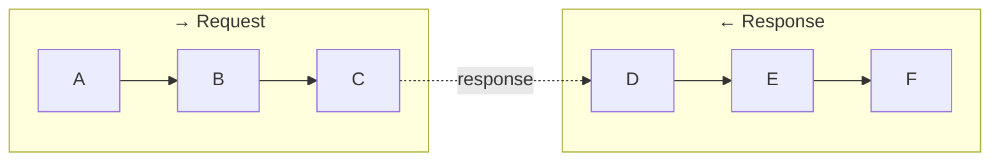
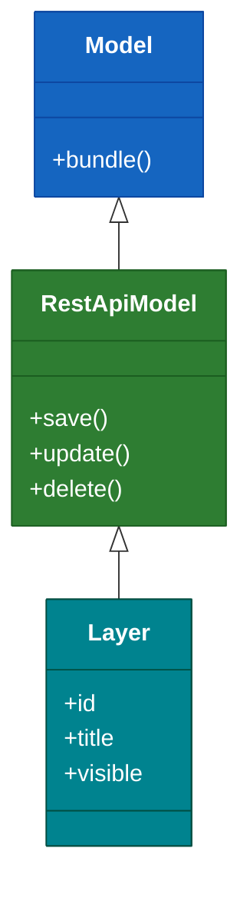

# Mermaid Rendering Guide

These rules answer **"does the diagram render well?"** — Mermaid syntax, layout primitives, spacing, padding, renderer-safe constructs. For architectural correctness (abstraction, edge meaning, terminal externals), see `architecture.md`. For semantic types (colors and shapes), see `semantic-types.md`.

## Default Diagram Type

Use:

```
flowchart TD
```

Top-down orientation produces the most readable architecture diagrams.

For class hierarchies (ES6 `extends` chains), use `classDiagram` instead — see the classDiagram section below.

## Orientation — TD vs LR

Use **Top-Down (TD)** for:

- system architecture
- service layers
- infrastructure diagrams
- component relationships

Use **Left-Right (LR)** for:

- pipelines
- workflows
- processing stages
- sequential flows

Avoid switching direction unnecessarily.

## Reserved Node IDs

Mermaid throws a parse error if you use reserved keywords as node IDs. Always abbreviate and put the full text in the label:

| Reserved word | Use instead |
|---|---|
| `click` | `CLK` |
| `end` | `END_` |
| `default` | `DEF` |
| `subgraph` | — (it's a block, not a node) |

```
click[/  click event  /]    ✗  parse error: click is a keyword
CLK[/  click event  /]      ✓  node ID is safe, label is readable
```

## Hexagon Shape — Banned

**Never use the `{{...}}` hexagon shape** — it is not supported in all Mermaid renderers (VS Code preview, GitLab markdown). It causes the label to render outside the shape or float below the connecting edge.

For external/backend nodes, use the ribbon shape `>"..."]` instead — see `semantic-types.md`.

```
BE>"  Backend API  "]       ✓ ribbon — always renders correctly
BE{{"  Backend API  "}}     ✗ hexagon — label may float below the arrow
```

## Spacing — `%%{init}%%` Block

Every diagram must include an `%%{init}%%` block. Default Mermaid spacing is too tight.

**Minimum `fontSize` is `20px`.** Smaller values make both the main label and `<small>` subtitles unreadable.

**Standard values (use for all flowcharts unless overriding):**

```
%%{init: {'themeVariables': {'fontSize': '20px'}, 'flowchart': {'nodeSpacing': 110, 'rankSpacing': 100}}}%%
```

**Orientation matters — `nodeSpacing` and `rankSpacing` swap roles:**

| Setting | In `flowchart TD` | In `flowchart LR` |
|---|---|---|
| `rankSpacing` | vertical gap between rows | horizontal gap between columns |
| `nodeSpacing` | horizontal gap between nodes in the same row | vertical gap between nodes in the same column |

So for a `flowchart LR` pipeline that looks too flat/cramped vertically, increase `nodeSpacing` (not `rankSpacing`).

**Do NOT use the `padding` flowchart option** — it stretches node shapes rather than adding empty space, making nodes huge with tiny text inside.

The goal: diagrams that feel **roomy** — nodes should never feel squished together. When in doubt, go higher.

## Adding Height to Horizontal Diagrams

`flowchart LR` diagrams with subgraphs often render as a thin horizontal strip — all nodes in a single row, with very little vertical space. Adjusting `nodeSpacing` and `rankSpacing` alone is not enough.

**Use invisible spacer nodes to force a second row inside each subgraph.** A row of spacer nodes connected with `~~~` (Mermaid's invisible-edge connector) forms a hidden second row that "inflates" the subgraph height:

```
subgraph REQ ["  → Request  "]
  direction LR
  A --> B --> C --> D --> E
  SP1[" "] ~~~ SP2[" "] ~~~ SP3[" "] ~~~ SP4[" "]
end

style SP1 fill:transparent,stroke:transparent,color:transparent
style SP2 fill:transparent,stroke:transparent,color:transparent
style SP3 fill:transparent,stroke:transparent,color:transparent
style SP4 fill:transparent,stroke:transparent,color:transparent
```

**Rules for spacer nodes:**

- Name them `SP1`, `SP2`, … to make them obviously non-semantic
- Use `" "` (single space) as label so they have near-zero width
- Connect with `~~~`, never with `-->` — invisible edges only
- Always style each spacer as transparent — never leave them unstyled
- Number of spacers ≈ half the number of real nodes in the row
- Declare spacers AFTER the real edges, so they don't pollute the edge list

Applied spacing for horizontal diagrams with subgraphs: `nodeSpacing: 90, rankSpacing: 110`.

## Subgraph Styling

For when to use subgraphs, see `architecture.md`. This section covers how to render them.

**Always apply a subtle background** so subgraphs are visually distinct without competing with node colors:

```
style REQ fill:#1a2035,stroke:#2e3a52,color:#ffffff
style RES fill:#1a2035,stroke:#2e3a52,color:#ffffff
```

This dark blue-gray is legible on both dark and light backgrounds. Use it for every subgraph — do not leave subgraphs unstyled.

**Names — short, directional when representing a flow phase:**

```
"  → Request  "
"  ← Response  "
"  Frontend  "
"  Data  "
```

Avoid long descriptive titles.

**Example — two directional phases:**



## Subgraph Title Padding

Subgraph titles sit tight against the content nodes below them by default. Do **not** use spacer nodes to fix this — spacer nodes add height at the **bottom** of the subgraph, leaving the title still cramped at the top.

**The correct fix: append `<br/><br/>` at the END of the subgraph label.** Subgraph labels support HTML. Trailing `<br/>` tags add blank lines below the title text, expanding the label area downward and pushing the content nodes lower:

```
subgraph PHASE1 ["  ① init() — restore IDs<br/><br/>  "]
  direction LR
  A --> B
end
```

- Append at the END (after the title text), not the start — leading `<br/>` makes the title float to the bottom of its area
- Use `<br/><br/>` (two breaks) for a comfortable gap — one is rarely enough
- **If a title wraps onto multiple lines**, add an extra `<br/>` to that subgraph to compensate. Match visual padding across subgraphs, not literal break count.
- Do **not** combine this with spacer nodes — they pull in opposite directions

## Edge Style — Solid vs Dashed

Prefer simple directional edges:

```
A --> B
```

- **Solid `-->`** = outgoing call / data flow / forward path
- **Dashed `-.->`** = returned data / response path

For when to label edges and what labels to use, see `architecture.md`.

## Edge Labels — Use Intermediate Nodes Instead

Edge labels (the text between `|...|`) render as tiny cramped boxes with no padding. There is no portable fix in sandboxed renderers (VS Code preview, GitLab markdown).

**The solution: use intermediate transition nodes instead of edge labels.** Nodes auto-size to their content, can be padded with spaces, and can be styled independently.

Use the stadium/pill shape `(["..."])` for transition nodes to visually distinguish them from process steps:

```
C --> CY(["  can handle  "]) --> D    ✓
C -->|can handle| D                   ✗  cramped label
```

Style transition nodes with a neutral gray to keep them visually subordinate:

```
classDef transition fill:#37474F,stroke:#546E7A,color:#cccccc,stroke-width:1px
class CY,SKIP,EY transition
```

Shared paths can reuse the same intermediate node:

```
C --> SKIP(["  skip  "])
D --> SKIP          ← both "skip" and "not found" paths merge here
SKIP --> E
```

## Avoid Edge Crossing

When possible:

- maintain vertical flow
- avoid diagonal connections
- group related nodes together

## Node Padding

Mermaid sizes nodes tightly around their text. To add internal padding, quote all node labels and add **three spaces on each side**:

```
A["   layer.resolveProperty   "]
B{"   canHandle?   "}
```

Apply this to **every node** for consistent appearance.

**Exceptions:**

- Pill nodes `(["..."])` use **4 spaces** outer padding — the rounded ends consume extra space, so one extra space restores perceived balance.
- `event` and `trigger` parallelogram nodes use **2 spaces** — they are intentionally compact to signal secondary importance:
  ```
  Mount[/  map mount  /]
  CLK[/  marker click  /]
  ```

## Line Breaks in Labels

Inside quoted labels (`"..."`) the `\n` escape does **not** produce a line break — use `<br/>` instead:

```
A["  line one<br/>line two  "]    ✓
A["  line one\nline two  "]       ✗  renders as literal \n
```

Unquoted labels (no `"`) can use `\n`, but since all labels should be quoted for padding, always use `<br/>`.

## Node Size Hierarchy via `<small>` Subtitles

Mermaid sizes nodes to fit their content — there is no explicit `width` or `height` property. Use label length and `<br/><small>` lines to create a visual size hierarchy that matches architectural importance.

Mermaid flowcharts have `htmlLabels: true` by default, so HTML tags render correctly. Use `<br/><small>` to add a subtitle line that appears smaller than the main label.

**When to add a `<small>` subtitle:** Whenever a node has meaningful secondary info — a method name, a clarifying role, a key behavior. Applies to any node type where the subtitle adds context not obvious from the main label.

```
MapComponent["   Map Component   <br/><small>   — entry point —   </small>"]
BE>"   Backend API   <br/><small>   station data   </small>"]
FS(["    useFiltersStore    <br/><small>   waterBodyType   </small>    "])
UA("   useApi   <br/><small>   exec / createEndpointExec   </small>")
```

For very small descriptive lists (e.g. `water districts · river basins`), nest two `<small>` tags:

```
GeoL(["    activeGeoLayers<br/><small><small>   water districts · river basins   </small></small>    "])
```

**When NOT to add a subtitle:** self-explanatory names, redundant rewordings, intentionally compact nodes (events, triggers, decisions).

```
uSC("   useStationsCluster   ")    ← single line — name is self-explanatory
MoveEnd[/  moveend  /]             ← parallelogram, 2-space, no subtitle
```

Apply `<small>` **consistently within a diagram**: if some composables get subtitles, all composables in that diagram with meaningful secondary info should too.

This creates a natural size hierarchy — nodes with more context are visually larger, without any manual sizing.

The minimum `fontSize: 20px` ensures `<small>` subtitles render at ~16px and `<small><small>` at ~12.8px — both legible at normal zoom.

## Diamond Node Rules

Decision diamonds (`{}`) have limited rendering space — long text gets cut off. Keep diamond labels:

- **single line if possible**, under 20 characters
- **two lines max** using `<br/>`, each line under 15 characters
- Never put full class names in diamonds — abbreviate: `CapabilitiesStrategy?` → `Capabilities<br/>Strategy?`

Rectangles (`[]`) scale freely to fit content. Diamonds do not — when in doubt, shorten.

## classDiagram Syntax

Use `classDiagram` when documenting an ES6 class hierarchy.

**Relationships:**

- inheritance: `ParentClass <|-- ChildClass`
- composition: `ParentClass *-- ChildClass : propertyName[]` — always include the property name as a label, so the reader immediately knows how the parent holds the child

**Class body — 5-entry hard limit:**

- Show only members that communicate the class's role in the hierarchy
- **Do not repeat collection properties already shown via composition arrows** — use that slot for a scalar property instead
- Detail belongs in the text description, not in the diagram

Apply colors with `style NodeName fill:...,stroke:...,color:...` — `classDef`/`class` does NOT work in `classDiagram`.

**Always include `%%{init}%%`** — without it, `classDiagram` uses tight defaults that make relationship labels unreadable:

```
%%{init: {'themeVariables': {'fontSize': '20px'}, 'classDiagram': {'nodeSpacing': 50, 'rankSpacing': 80}}}%%
classDiagram
```

Labeled relationships (`*-- ChildClass : label`) need the extra `rankSpacing` to be legible — without it the label overlaps the arrow.

Example:



## Diagram Titles and Spacing

Every diagram must be preceded by a `##` heading that names it.

When there are multiple diagrams, add `<br><br>` after the closing fence of each diagram to create extra vertical space before the next heading:

```markdown
## Class Hierarchy

\`\`\`mermaid
...
\`\`\`

<br><br>

## Data Flow

\`\`\`mermaid
...
\`\`\`
```

## Mermaid Block Rules

Always output diagrams inside a Mermaid block. Never place text inside the block that is not valid Mermaid syntax.

## Rendering Safety

Ensure the diagram:

- renders without syntax errors
- maintains consistent orientation
- avoids visual clutter
- remains readable in both dark and light themes
